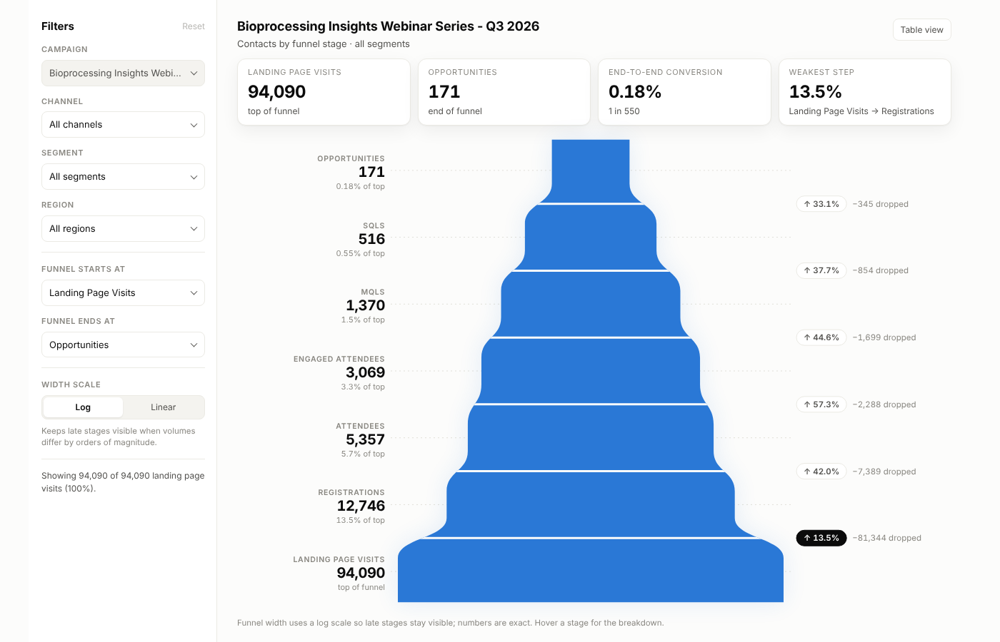

# Flow Funnel: a custom Sigma plugin built with D3.js

A vertical, single-color **flow funnel** for marketing campaigns, with a **dropdown filter sidebar**, built as a **Sigma Computing custom plugin** with **D3 v7**. The widest stage sits at the bottom and volume narrows upward. Stage names and volumes are on the left, step conversion on the right, and crisp horizontal lines separate the stages.



## Highlights

- **Custom visual, not a stock chart**: one silhouette with smooth `curveBumpY` transitions between stage plateaus, horizontal separators clipped to the silhouette, a hover highlight per stage, and animated morphing on every filter change.
- **Multi-select dropdown filters**: one dropdown per dimension; tick any number of values (with top-of-funnel counts, *Select all*, *Clear* and an *only* shortcut), funnel start/end stage, Log/Linear width, an active-filter badge and Reset. The subtitle and a "Showing X of Y" summary always reflect the active filters.
- **Breakdown on hover**: each stage's tooltip shows volume, conversion from the previous stage, and the split by channel. Table view shows the same split.
- **Decision-oriented KPIs**: top of funnel, end of funnel, end-to-end conversion, and the **weakest step**, which is also highlighted in the chart.
- **Honest encoding**: funnel width uses a **log scale** by default, so late stages (Opportunities ≈ 0.2% of visits) stay visible. Numbers are always exact, a footnote discloses the scale, and **Linear** is one click away in the sidebar.
- **Accessible**: single color with all values printed as text, native dropdowns (keyboard and screen-reader friendly), a **table view**, and an `aria-label` summary on the SVG.
- **Responsive**: on narrow tiles and phones, the sidebar moves to the top and collapses.
- **Production-minded**: pinned library versions, empty/loading/error states, "Other" folding past 7 breakdown values, and filter state that survives Sigma data refreshes.

## Dataset (fixed)

`data/campaign_funnel.csv` is the single source of truth: **420 rows**, 5 channels × 4 segments × 3 regions × 7 stages, for a fictional B2B life-sciences campaign (*Bioprocessing Insights Webinar Series, Q3 2026*). Stages run from Landing Page Visits to Registrations, Attendees (webinar platform), Engaged Attendees, MQLs, SQLs and Opportunities. Conversion differs by segment and region (for example, Pharma converts end-to-end at ~0.30% and Academic & Government at ~0.02%), so the filters tell real stories.

| column | type | example |
|---|---|---|
| campaign | text | Bioprocessing Insights Webinar Series - Q3 2026 |
| channel | text | Email Nurture |
| segment | text | Pharma |
| region | text | North America |
| stage | text | Registrations |
| stage_order | integer | 2 |
| contacts | integer | 4236 |

`data/campaign_funnel.js` contains the same rows. The standalone preview uses it because browsers block `fetch()` of local files opened by double-click. Upload the CSV to Sigma (or load it into Snowflake) to test the plugin against the exact same numbers.

## Architecture

```
index.html              styles + pinned D3 / Sigma SDK + load diagnostics
src/funnel-chart.js     pure D3 visual: knows nothing about Sigma or filters
src/filter-panel.js     generic sidebar: a dropdown for any list of dimensions
src/sigma-adapter.js    controller + Sigma contract: editor panel, subscriptions,
                        columnar → rows → filter → normalize(), states, variable
data/                   fixed dataset (CSV + generated JS)
```

Sigma delivers element data **column by column** (`{ colId: [values] }`). The adapter turns it into long rows `{ stage, order, value, dims }`, applies the sidebar filters, and runs `normalize()`, which aggregates and slices the stage range, keeping a per-value breakdown for the tooltip and table. The **standalone preview goes through the same `normalize()`**, so what you see locally is what Sigma renders.

## Run it

- **Quick look**: extract the zip and double-click `index.html`.
- **Local server** (required for Sigma): `python -m http.server 3000`, then open http://localhost:3000. Add `?scale=linear` to compare scales.

## Use it in Sigma

1. Upload `data/campaign_funnel.csv` to a workbook (or point to the table in your warehouse).
2. **Add element › UI › Plugin › Sigma Plugin Dev Playground** (it points to `http://localhost:3000`).
3. Map the editor panel: **Data source** = the table, **Stage** = `stage`, **Value** = `contacts`, **Stage order** = `stage_order`, **Dimensions** = `channel`, `segment`, `region` (each becomes a sidebar dropdown; the first one is used for the hover breakdown).
4. Optional: create a text control and select it under *Control to receive the clicked stage*. Clicking a stage then filters any element bound to that control (for example, a contact-level detail table).

To publish, host the folder (GitHub Pages, Netlify...) and register it as a plugin in Sigma's Admin Portal with that **Production URL**.

## Release strategy (DEV → PROD)

A Sigma plugin is a hosted URL, so every dashboard picks up a deploy immediately:

- Pin library versions (done in `index.html`).
- Version the URL per major release (`/v1/`, `/v2/`) and register breaking versions as separate plugins.
- Test on a preview deploy plus a UAT workbook before merging to `main`. Roll back by reverting the commit.
- Keep editor-panel changes **additive** within a major version: renaming or removing an option drops the saved configuration in existing workbooks.

## Talking points

- *"The visual is a pure render module. The adapter owns Sigma's contract, so AI-generated or analyst-built visuals only need to implement `update(model, spec)`."*
- *"Volumes span almost three orders of magnitude, so total height is log-scaled while shares within a stage stay linear. The encoding is disclosed in the chart and switchable."*
- *"The sidebar is driven by whatever dimensions the analyst maps in Sigma, so the same plugin serves any campaign table without code changes."*
- *"Every filter change keeps the same path structure, so D3 interpolates the silhouette smoothly, and the separators are clipped to that same path, so they always follow the shape."*
